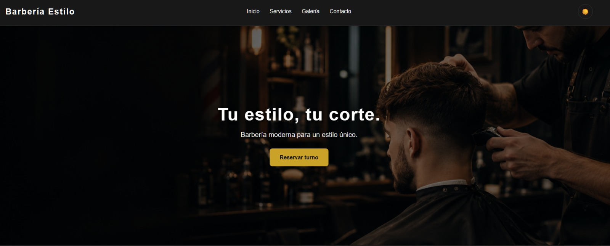
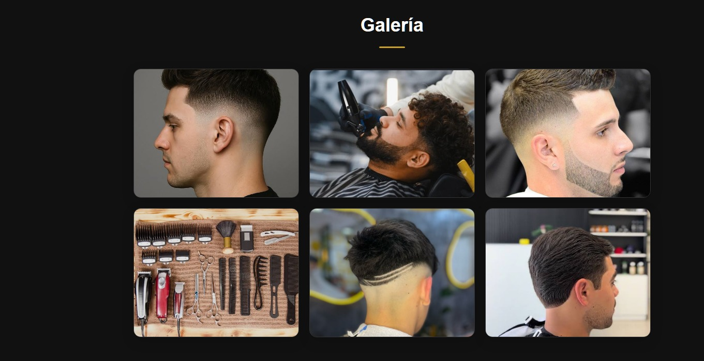

# 💈 Barbería Estilo

Página web de muestra para una barbería moderna, diseñada para presentar sus servicios, mostrar cortes de cabello y facilitar el contacto con potenciales clientes.

## 🌐 Demo online

**[Visitar Barbería Estilo](https://AlanVasilatos.github.io/barberia-estilo/)**

## 📸 Vista previa

## ✨ Funcionalidades

- Diseño moderno y adaptable a computadoras, tablets y celulares.
- Secciones de Inicio, Servicios, Galería y Contacto.
- Galería con seis imágenes.
- Modo claro y modo oscuro.
- Formulario de contacto con validaciones.
- Mensajes temporales para indicar errores y confirmar el envío del formulario.

## 🛠️ Tecnologías utilizadas

- HTML5
- CSS3
- JavaScript

## 📂 Estructura del proyecto

- `index.html`: estructura de la página.
- `style.css`: estilos y diseño visual.
- `galeria-1.jpg` a `galeria-6.jpg`: imágenes de la galería.
- `hero-barberia.png`: imagen principal.

## 🎯 Objetivo

Proyecto de práctica desarrollado para mejorar habilidades de diseño web, maquetación, interactividad y adaptación a diferentes dispositivos.

## 👨‍💻 Autor

Desarrollado como parte de mi portfolio de proyectos web.
